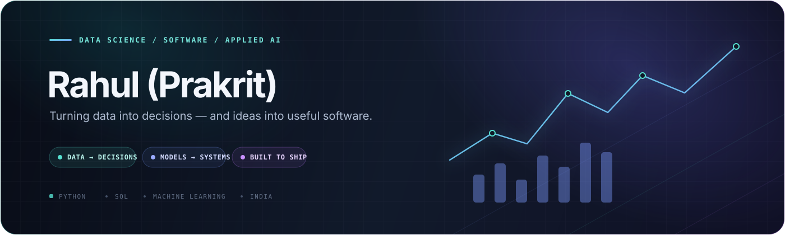
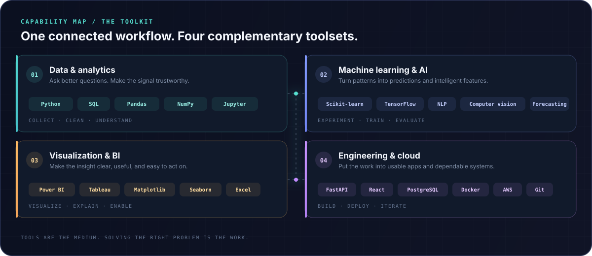

<div align="center">



<br />


<br />

[](https://rdrahul123.github.io/Portfolio-v3/)
[](https://www.linkedin.com/in/rahul-dodke/)
[](https://www.kaggle.com/prakrit0566)
[](https://leetcode.com/u/rahul0566)

<br />


</div>

<br />

<div align="center">

`DATA → DECISIONS → SYSTEMS` &nbsp; ✦ &nbsp; Building with curiosity from **India**

</div>

<br />

<div align="center">

&nbsp;[&nbsp;**About**&nbsp;](#about)&nbsp;·&nbsp;[&nbsp;**Projects**&nbsp;](#selected-projects)&nbsp;·&nbsp;[&nbsp;**Toolkit**&nbsp;](#the-toolkit)&nbsp;·&nbsp;[&nbsp;**Learning**&nbsp;](#currently-exploring)&nbsp;·&nbsp;[&nbsp;**Stats**&nbsp;](#github-by-the-numbers)&nbsp;·&nbsp;[&nbsp;**Connect**&nbsp;](#have-a-good-problem-to-solve)&nbsp;

</div>

---

## About

I'm **Rahul (Prakrit) Dodke** — a data science analyst who enjoys working across the whole problem-solving loop: understanding the question, making the data trustworthy, finding the signal, and delivering something people can actually use.

My toolkit spans **Python, SQL, analytics, machine learning, and software engineering**. I'm especially interested in practical ML, forecasting, computer vision, and the fast-moving world of LLMs and RAG.

> **Currently:** building with LLMs & RAG, sharpening forecasting workflows, and turning messy data into dependable pipelines.

<br />

<div align="center">

| ⚡ **SNAPSHOT** | |
|:---|:---|
| 📍 **Based in** | India |
| 🎯 **Focus** | Data science, applied ML & LLMs |
| 🛠 **I build** | Forecasting pipelines, AI tools & clean web apps |
| 🌱 **Learning** | RAG systems, fine-tuning & production ML |
| 🤝 **Open to** | Thoughtful collaborations & good problems |

</div>

<br />

<div align="center">

| &nbsp;UNDERSTAND&nbsp; | &nbsp;BUILD&nbsp; | &nbsp;SHIP&nbsp; |
|:---|:---|:---|
| Start with the real question, not the dataset. | Keep the pipeline reproducible and the code readable. | Deliver something a person can actually use. |

</div>

<br />

<div align="center">✦ &nbsp; · &nbsp; ✦ &nbsp; · &nbsp; ✦</div>

## Selected projects

<div align="center">

| &nbsp;01 · FORECASTING &nbsp; | &nbsp;02 · FULL-STACK + AI &nbsp; |
|:---|:---|
| **📈 [Sales Forecasting](https://github.com/RDrahul123/Sales-Forecasting)**<br />An end-to-end, reproducible system predicting daily sales at the store level — three model families, a Python pipeline, and an interactive web app.<br /><br />`PYTHON` &nbsp; `MACHINE LEARNING` &nbsp; `TIME SERIES` | **✅ [MarkIt](https://github.com/RDrahul123/MarkIt---AI-Powered-Attendance-Manager)**<br />A full-stack attendance manager bringing together Excel workflows, real-time tracking, AI-assisted analytics, and PWA support.<br /><br />`REACT` &nbsp; `FASTAPI` &nbsp; `POSTGRESQL` |
| &nbsp;03 · LEARNING IN PUBLIC &nbsp; | &nbsp;04 · CREATIVE TOOLING &nbsp; |
| **🧠 [LLMs](https://github.com/RDrahul123/LLMs)**<br />A free, open course on large language models — from first principles to prompt engineering, APIs, RAG, and fine-tuning.<br /><br />`PYTHON` &nbsp; `LLMS` &nbsp; `RAG` | **🗒️ [Notiva Notes](https://github.com/RDrahul123/Notiva-Notes)**<br />An offline-first, graph-based notes app inspired by Obsidian. No account, no server — your notes stay in your browser.<br /><br />`HTML` &nbsp; `JAVASCRIPT` &nbsp; `OFFLINE-FIRST` |

</div>

<br />

### More work

<div align="center">

| Project | What it is | Stack |
|:---|:---|:---|
| **[Sentiment Analysis](https://github.com/RDrahul123/Sentiment-Analysis)** | A self-contained sentiment web app with a dark UI, live training, dataset management, and real-time predictions. | `PYTHON` `NLP` |
| **[System Design](https://github.com/RDrahul123/System-Design)** | A free, open course on designing useful, scalable, and dependable software systems. | `JAVASCRIPT` |
| **[Git & GitHub](https://github.com/RDrahul123/Git-and-GitHub)** | A standalone learning path: mental models first, then practice, workflows, and troubleshooting. | `GIT` |
| **[My Python Codes](https://github.com/RDrahul123/My_Python-codes)** | A growing collection of Python programs and notebooks from daily practice and experiments. | `PYTHON` `JUPYTER` |

</div>

<div align="center">

**[Explore the full portfolio ↗](https://rdrahul123.github.io/Portfolio-v3/)**

</div>

<br />

<div align="center">✦ &nbsp; · &nbsp; ✦ &nbsp; · &nbsp; ✦</div>

## The toolkit

<div align="center">



<br /><br />


</div>

<div align="center">

`EXPLORE THE DATA` &nbsp; → &nbsp; `FIND THE SIGNAL` &nbsp; → &nbsp; `MAKE IT USEFUL`

</div>

<br />

## Currently exploring

<div align="center">

```text
LLMs & RAG                ██████████░░░░░░   hands-on, daily
Forecasting               █████████░░░░░░░   sharpening workflows
Applied ML & CV           ████████░░░░░░░░   building models that ship
Reliable data pipelines   ███████░░░░░░░░░   making data trustworthy
```

</div>

<br />

## GitHub, by the numbers

<div align="center">


<br /><br />


<br /><br />


<br /><br />


</div>

<br />

## Contribution calendar

<div align="center">

<picture>
  <source media="(prefers-color-scheme: dark)" srcset="https://raw.githubusercontent.com/RDrahul123/RDrahul123/output/github-contribution-grid-snake-dark.svg" />
  <source media="(prefers-color-scheme: light)" srcset="https://raw.githubusercontent.com/RDrahul123/RDrahul123/output/github-contribution-grid-snake.svg" />
  
</picture>

<sub>A little snake, a lot of commits. The contribution animation refreshes daily.</sub>

</div>

<br />

<div align="center">✦ &nbsp; · &nbsp; ✦ &nbsp; · &nbsp; ✦</div>

## Beyond the code

<div align="center">

☕ Chai-fueled deep work &nbsp; · &nbsp; 🎧 Lo-fi playlists & foraging tutorials on loop &nbsp; · &nbsp; ✍️ Notes turned into open courses

🧩 I enjoy teaching as much as building — most of my repos started as study notes someone else might find useful &nbsp; · &nbsp; 🔍 Perpetually curious

</div>

<br />

<div align="center">

### Have a good problem to solve?

I'm always up for thoughtful conversations, interesting collaborations, and opportunities to build meaningful things.

[**Say hello on LinkedIn ↗**](https://www.linkedin.com/in/rahul-dodke/) &nbsp; · &nbsp; [**Browse my work ↗**](https://rdrahul123.github.io/Portfolio-v3/) &nbsp; · &nbsp; [**Follow on GitHub ↗**](https://github.com/RDrahul123)

<br />

*"I glide, I pivot, I thrive, I shine, and my peace is fully paid."* 🤓

<sub>Made with curiosity, clean data, and a little bit of ☕</sub>

</div>
